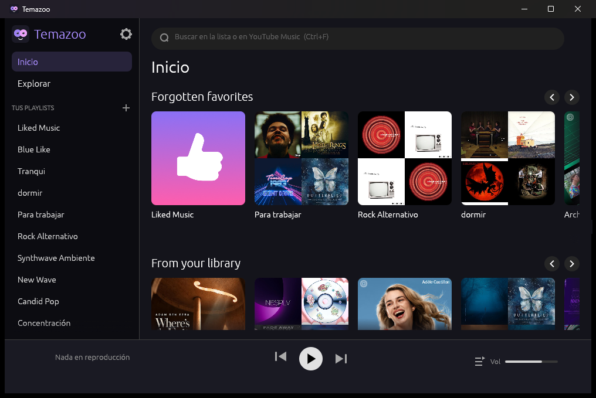

# Temazoo

Reproductor de escritorio de **YouTube Music** para Windows, hecho en Rust para gastar poca memoria.
Una app de navegador o Electron ronda 1 GB de RAM; Temazoo arranca en ~200 MB y, navegando con carátulas, se mantiene entre 350 y 450 MB.

**Sitio:** https://fiambre.github.io/temazoo/



## Qué hace

- **Inicio y Explorar** como en YouTube Music (estantes, categorías, continuación al hacer scroll).
- **Búsqueda** de canciones, artistas y álbumes, con páginas de artista y de álbum.
- **Tus playlists**: crear, editar, borrar, agregar y quitar canciones. Me gusta con un clic.
- **Cola** con arrastrar para reordenar, reproducir al pinchar la carátula y sugerencias automáticas cuando se acaba.
- **Audio** en Opus (mejor calidad) o AAC, a elegir en Configuración. Precarga la siguiente canción.
- **Teclas multimedia** de Windows, `Espacio` para pausar y `Ctrl+←/→` para anterior/siguiente.
- **Inicio de sesión** con una ventana de Google (WebView2). La sesión se renueva sola.
- **Actualizaciones automáticas**: avisa cuando hay una versión nueva y se instala con un clic. yt-dlp se actualiza solo.

## Instalación

Descargá `Temazoo-Setup-x.y.z.exe` desde [Releases](../../releases/latest) y ejecutalo.
Se instala por usuario, sin permisos de administrador, y crea accesos directos en el escritorio y el menú inicio.

Requisitos: Windows 10/11 con WebView2 (ya viene en Windows 11). En el primer arranque, entrá a Configuración → *Iniciar sesión*.

Tus datos (sesión y ajustes) quedan en `%LOCALAPPDATA%\Temazoo` y **no se borran al desinstalar**.

## Cómo está hecho

| Pieza | Tecnología |
|---|---|
| Interfaz | [egui](https://github.com/emilk/egui) / eframe 0.37 (backend `glow`) |
| API de YouTube Music | [`ytmusicapi`](https://crates.io/crates/ytmusicapi) (Rust) + peticiones directas para lo que no cubre |
| Audio | [rodio](https://github.com/RustAudio/rodio) + [symphonia](https://github.com/pdeljanov/Symphonia) (AAC) + Opus en Rust |
| Resolución de streams | [yt-dlp](https://github.com/yt-dlp/yt-dlp) |
| Inicio de sesión | wry + tao (WebView2) |
| Controles multimedia | souvlaki |

Para mantener la RAM baja: sin `wgpu`, carátulas reducidas a 96/256 px y una caché LRU que descarta las imágenes que no se ven.

> yt-dlp es Python empaquetado, así que la resolución del audio no es Rust puro. Se probaron alternativas en Rust y no resolvían los streams de forma fiable.

## Compilar

Necesitás Rust estable y `bin\yt-dlp.exe` ([descarga](https://github.com/yt-dlp/yt-dlp/releases/latest)).

```powershell
cargo run --release
```

Fuera de una instalación, la app lee `headers.json` y `config.json` de la carpeta actual. `headers.json` guarda tu cookie de Google: **no lo subas a ningún repositorio** (ya está en `.gitignore`).

## Releases

El workflow [`release.yml`](.github/workflows/release.yml) compila, descarga yt-dlp, arma el instalador con NSIS y lo publica al subir un tag `v*`:

```powershell
git tag v0.3.0
git push origin v0.3.0
```

La versión de la app se toma del tag. Para probar el instalador en local: `makensis /DVERSION=0.0.0 installer\temazoo.nsi` (genera `dist\`).

## Aviso

Proyecto personal, no afiliado a Google ni a YouTube. Usa tu propia cuenta y las mismas funciones que la web de YouTube Music; respetá sus términos de servicio.
